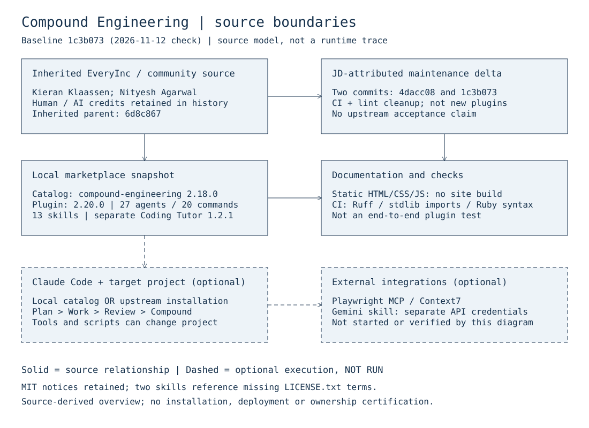

# Compound Engineering Plugin

A Claude Code plugin that makes each unit of engineering work easier than the last.

## Provenance and scope of this checkout

This repository retains Every's compound-engineering marketplace and community
history. It is not a claim that JD created the inherited plugins. The catalog
credits **Every Inc.**, compound-engineering author **Kieran Klaassen**, and
Coding Tutor author **Nityesh Agarwal**. Preserve those credits, community
contributions, and the human/AI co-author records in Git history.

Source baseline checked on **2026-11-12**: `main` at
[`1c3b0731de3c7c5fbc281c7bdedc6b5f1724d43a`](https://github.com/JDKristenson/compound-engineering-plugin/tree/1c3b0731de3c7c5fbc281c7bdedc6b5f1724d43a).
The inherited parent is
[`6d8c867`](https://github.com/EveryInc/compound-engineering-plugin/commit/6d8c8675f301feb7677ba2c6d40b6632a016a6d2),
whose commit credits Kieran Klaassen and Claude Opus 4.5. Two subsequent
JD-attributed commits on March 29, 2026 add
[CI and Python lint cleanup](https://github.com/JDKristenson/compound-engineering-plugin/commit/4dacc08122f08adf9b7d9348ec701ae4d532c587)
and [correct the Ruff configuration invocation](https://github.com/JDKristenson/compound-engineering-plugin/commit/1c3b0731de3c7c5fbc281c7bdedc6b5f1724d43a).
Their net delta is 13 files, 114 insertions and 23 deletions—not a new plugin
implementation. Commit identities do not establish exclusive authorship or
human-only work, and this comparison does not establish upstream acceptance,
current upstream synchronization, local installation, or deployment.

The documentation and editable diagram added after this baseline are
AI-assisted maintenance prepared with Reason; they do not replace inherited
attribution.

## Install: upstream versus this snapshot

**Source-derived instructions below are NOT RUN in this documentation change.**
This is a Claude Code plugin marketplace, not a standalone application with an
npm build. The existing [getting-started guide](docs/pages/getting-started.html)
lists configured Claude Code, a GitHub account, and Node.js 18+ for MCP servers;
compatibility with current tools has not been exercised here.

### Use upstream

Enter these slash commands inside Claude Code:

```text
/plugin marketplace add https://github.com/EveryInc/compound-engineering-plugin
/plugin install compound-engineering
```

This selects **upstream**, not this JD checkout, the pinned baseline, or the
local CI/lint changes described above.

### Inspect or install a local snapshot

For an already obtained checkout at the revision intended for evaluation, the
[repository's local-testing guidance](CLAUDE.md#test-locally) uses this CLI route
(replace the placeholder with its absolute path):

```text
claude /plugin marketplace add <absolute-path-to-checkout>
claude /plugin install compound-engineering
```

The catalog retains the marketplace identifier `every-marketplace`. Avoid
confusing a locally registered catalog with a previously registered upstream
catalog; check the selected source in Claude Code before installing. No plugin
installation, plugin command execution, MCP server startup, or plugin-service
API call was performed for this change. Plugin use can run tools and scripts in a target
project; optional image-generation features require their own dependencies and
credentials. Review the relevant skill before enabling it—never commit secrets.

### Documentation and validation

The [documentation site](docs/index.html) is static HTML/CSS/JS with **no build
step**. Open that file in a browser (`open docs/index.html` on macOS), as described
in [repository instructions](CLAUDE.md#viewing-docs-locally). Some assets and
integrations use external services; offline viewing is not a complete runtime
test. Python and Ruby support files are utilities, not a single app entry point.

The [CI workflow](.github/workflows/ci.yml) runs Ruff, installs requirements,
checks selected standard-library imports, and checks Ruby syntax. Its import
job is not a project-module or end-to-end plugin test. Check the PR's actual
results rather than treating workflow configuration as evidence of passing CI.

## Snapshot inventory and known drift

At the pinned baseline, recursive tracked-file counts are **27 agent Markdown
files, 20 command Markdown files, and 13 skill definitions** for
compound-engineering. Its [plugin manifest](plugins/compound-engineering/.claude-plugin/plugin.json)
declares **2.20.0** and two MCP integrations (`pw`/Playwright and Context7).
The [marketplace catalog](.claude-plugin/marketplace.json) instead declares
**2.18.0** and **19 commands**. These are observed inconsistencies, not separate
verified releases. Older counts and repository names also remain in inherited
guides. This docs-only change does not silently alter release metadata or claim
that all reference pages are synchronized.

The catalog separately includes [Coding Tutor](plugins/coding-tutor/README.md)
at version 1.2.1; it is not part of the compound-engineering counts above.

## License and attribution status

- [Root MIT license](LICENSE): Copyright 2025 Every.
- [Compound-engineering MIT license](plugins/compound-engineering/LICENSE):
  Copyright 2025 Kieran Klaassen. Preserve applicable notices and disclaimers.
- [frontend-design](plugins/compound-engineering/skills/frontend-design/SKILL.md)
  and [skill-creator](plugins/compound-engineering/skills/skill-creator/SKILL.md)
  explicitly refer to `LICENSE.txt`, but no such file is tracked at the baseline.
  Those referenced terms and their historical provenance remain unresolved;
  do not assume the root MIT declaration resolves that gap before repackaging
  those components.
- The documentation site credits LaunchKit by Evil Martians in its
  [footer](docs/index.html). Preserve that attribution. External dependencies,
  assets, and services have their own terms; this is not comprehensive license
  clearance or a new blanket license grant.

## Editable source-boundary diagram

[Preview](docs/diagrams/source-boundaries.svg) ·
[Editable Excalidraw](docs/diagrams/source-boundaries.excalidraw) ·
[Diagram scope and regeneration](docs/diagrams/README.md)



## Workflow

```
Plan → Work → Review → Compound → Repeat
```

| Command | Purpose |
|---------|---------|
| `/workflows:plan` | Turn feature ideas into detailed implementation plans |
| `/workflows:work` | Execute plans with worktrees and task tracking |
| `/workflows:review` | Multi-agent code review before merging |
| `/workflows:compound` | Document learnings to make future work easier |

Each cycle compounds: plans inform future plans, reviews catch more issues, patterns get documented.

## Philosophy

**Each unit of engineering work should make subsequent units easier—not harder.**

Traditional development accumulates technical debt. Every feature adds complexity. The codebase becomes harder to work with over time.

Compound engineering inverts this. 80% is in planning and review, 20% is in execution:
- Plan thoroughly before writing code
- Review to catch issues and capture learnings
- Codify knowledge so it's reusable
- Keep quality high so future changes are easy

## Learn More

- [Full component reference](plugins/compound-engineering/README.md) - all agents, commands, skills
- [Compound engineering: how Every codes with agents](https://every.to/chain-of-thought/compound-engineering-how-every-codes-with-agents)
- [The story behind compounding engineering](https://every.to/source-code/my-ai-had-already-fixed-the-code-before-i-saw-it)
